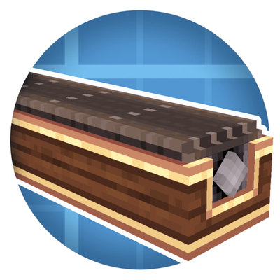

<h1 align="center">Create: Better Belt 

</h1>

> [!IMPORTANT]
> This mod is in beta and under active development, bugs are expected. [Please report any issues](https://github.com/PedroRok/CreateBetterBelts/issues)!
>
> Available for **Fabric** and **NeoForge** on Minecraft 1.21.1. Requires [Create](https://modrinth.com/mod/create) 6.0 or newer (and [Fabric API](https://modrinth.com/mod/fabric-api) on Fabric)

### Welcome to Create: Better Belt!

Create: Better Belt is a small addon for the Create mod that removes a few of the limits of mechanical belts. Belts can now run **through** a shaft instead of only across it, connect shafts that point in **different directions**, and be **reversed** with a single wrench click. Everything is built with Create's own Belt Connector, so there is nothing new to learn